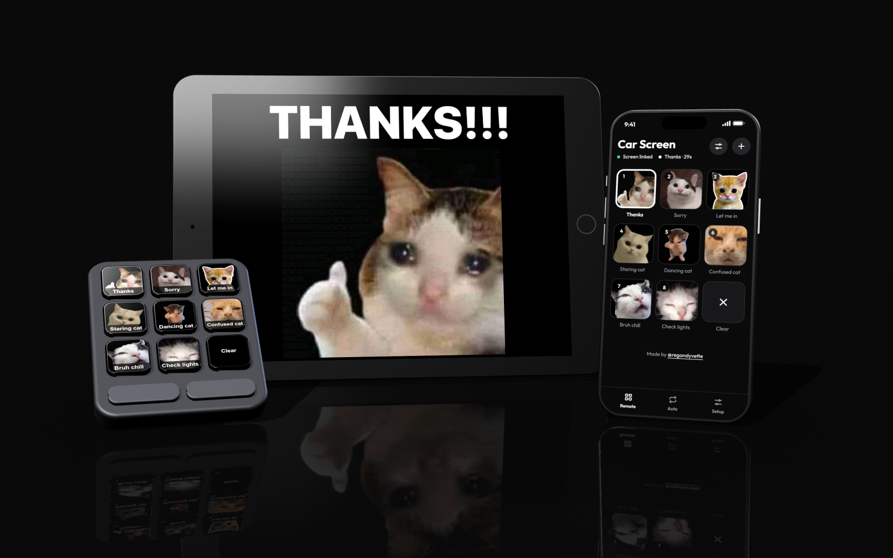
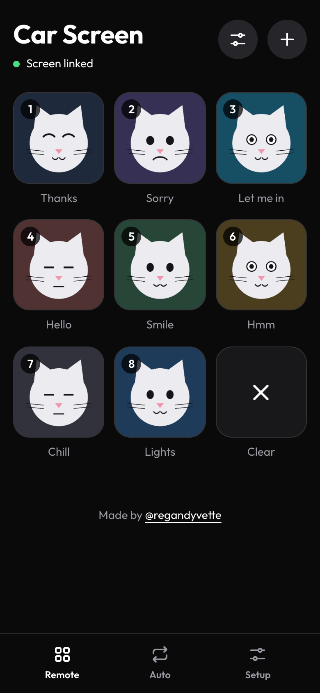
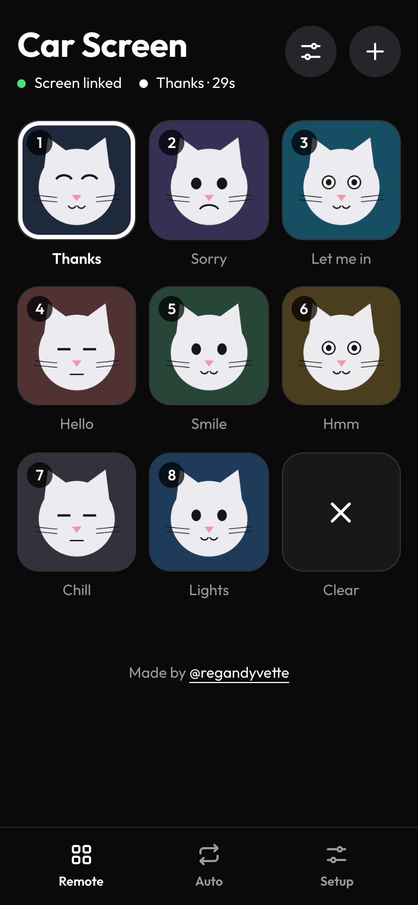
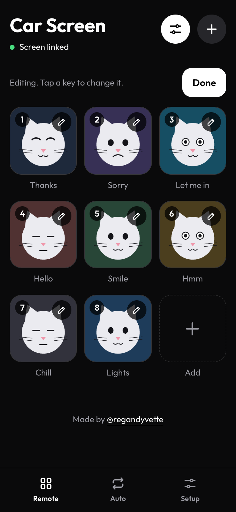
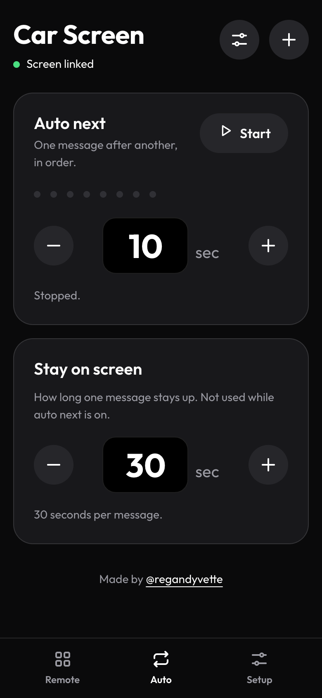
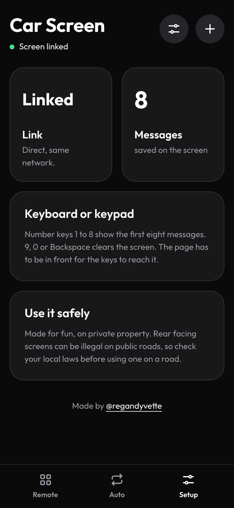
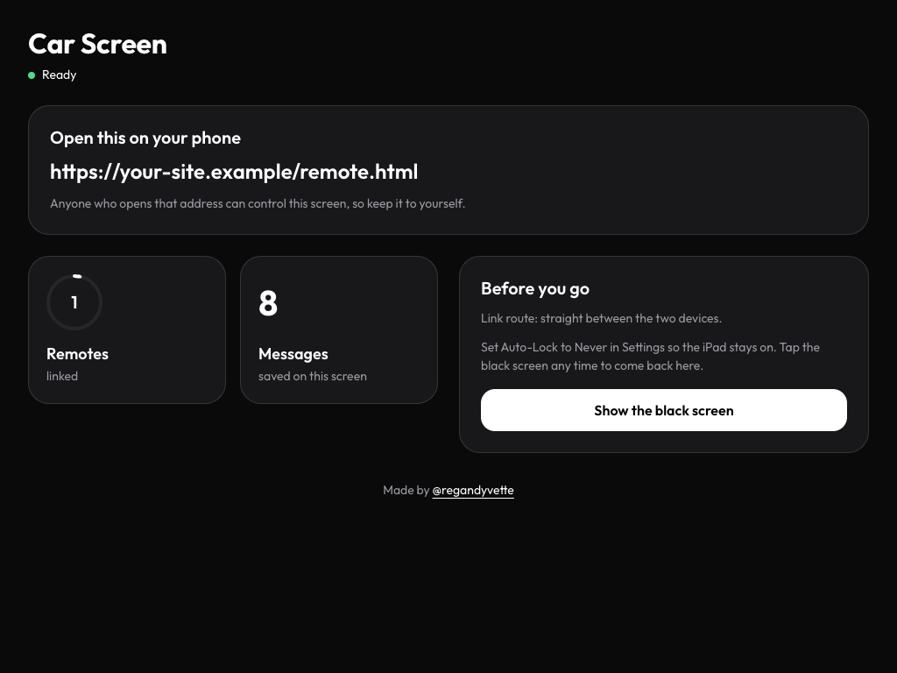
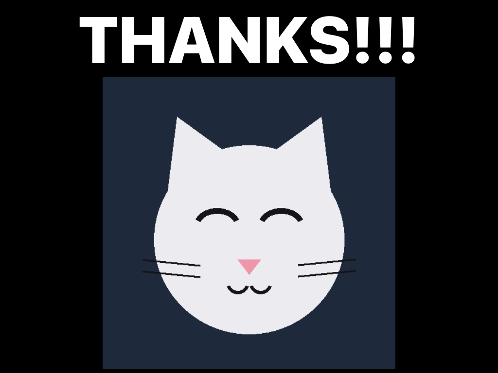

# Car Custom Display

A phone and an old iPad are all you need. The iPad sits on a black screen.
Press a key on your phone and a picture or a few words show up on the iPad.
Add, change and delete your own messages and pictures. No laptop, no extra
hardware, no accounts.

> **Read the [DISCLAIMER](DISCLAIMER.md) first.** This is a fun project for
> private property. A screen that faces outside a vehicle may be illegal on
> public roads where you live. You use it at your own risk.
>
> **Personal use only.** Free to build for yourself. Not for sale or commercial
> use. See the [LICENSE](LICENSE).

## The fast way: hand it to your coding assistant
If you use a coding assistant, give it this repo and this message:

> Set up the project at https://github.com/regandyvette/car-custom-display for me
> by following AGENTS.md. Read DISCLAIMER.md first and tell me what it says.
> Fork it to my GitHub, ask me what hardware I have and which free host I use
> (Vercel, Netlify, Cloudflare Pages or GitHub Pages), set it up there, then
> tell me the address and exactly what to do on my screen and my remote.

[AGENTS.md](AGENTS.md) holds the exact steps, how to change the starter
messages and colors, and a fix list for common problems. You can also follow
the steps below yourself.

## What it looks like
**The Remote (the console you press)**

| Keys | Key pressed | Edit mode |
| --- | --- | --- |
|  |  |  |

| Auto tab | Setup tab |
| --- | --- |
|  |  |

**The Screen (what shows in the car)**

| Setup layer (tap the black screen) | Showing a message |
| --- | --- |
|  |  |

## What you need
- Something with a screen to be the **Screen** (see the hardware options
  below).
- Something to be the **Remote**: a phone, or a computer with a keyboard or
  macro keypad.
- A free [GitHub](https://github.com) account and any free static web host
  (Vercel, Netlify, Cloudflare Pages or GitHub Pages) to run your own copy.
- Internet on both devices. A phone hotspot works.

## Build your own in 5 steps
1. **Fork this repo** on GitHub (the Fork button, top right).
2. **Host it.** Pick any free host from [Host it anywhere](#host-it-anywhere)
   below. Vercel is the quickest, but you do not need it. There is no build
   step.
3. **Open your site on the iPad**, press Screen, then in Safari use Share and
   Add to Home Screen. Open it from the new Home Screen icon. In the iPad
   Settings set Auto-Lock to Never so the screen stays on.
4. **Open your site on your phone**, press Remote. The status line says
   "Screen linked" when the two find each other.
5. **Press a key.** The picture shows on the iPad. The last key clears it.

Tap the black screen on the iPad any time to get back to its setup layer.

## Pick your hardware
The Screen and the Remote only need a modern browser and internet. Mix and
match.

**The Screen (what shows the picture)**
| You have | Do this |
| --- | --- |
| An old iPad or tablet | Open the site, press Screen, Add to Home Screen, set Auto-Lock to Never. This is what the original uses. |
| An old phone | Same as a tablet. |
| A laptop or mini PC wired to a monitor or car display (HDMI, USB-C, DisplayPort) | Open the site in a browser, press Screen, make the browser full screen. This is the wired option: the cable only carries the picture to the display. |
| A Raspberry Pi or similar | Same as a laptop, with the browser in full screen (kiosk) mode. |

**The Remote (what you press)**
| You have | Do this |
| --- | --- |
| Just a phone | Open the site, press Remote, tap the keys. |
| A laptop or desktop with a keyboard | Open Remote and press 1 to 8 for the messages, and 9, 0 or Backspace to clear. Keep that browser tab in front. |
| A Bluetooth or USB keyboard, or a tablet with a keyboard | Same keys as above. Pair or plug it into the device that has the Remote page open. |
| A macro keypad (Logitech MX Creative Keypad, Elgato Stream Deck, or any programmable pad) | Set the keys to send plain number keys 1 to 8, and 9 to clear, then open Remote on the computer it is plugged into. Keep that tab in front. |
| Two spare phones | One is the Screen, one is the Remote. |

Number keys only work while the Remote page is open and in front, and when
you are not in Edit mode. Keys held with Ctrl, Cmd or Alt are ignored.

**What is not supported**
The Screen and the Remote find each other over the internet and then talk
directly. A direct Bluetooth link or USB cable from the controller to the
screen, with no internet at all, does not work in this version. Wired and
Bluetooth work for the keyboard or keypad and for the display, as above, but
both devices still need a connection to the internet (a phone hotspot is
enough).

## Host it anywhere
The app is plain files, so any host that serves static files over `https`
works. Pick one:

| Host | How |
| --- | --- |
| **Vercel** | vercel.com/new, import your fork, press Deploy. No settings. |
| **Netlify** | app.netlify.com, Add new site, Import from GitHub, pick your fork. Leave build command and publish directory empty. Or drag the folder onto the Netlify Drop page. |
| **Cloudflare Pages** | Create a project, connect your fork, framework preset None, leave the build command empty and the output directory `/`. |
| **GitHub Pages** | In your fork: Settings, Pages, Deploy from a branch, branch `main`, folder `/ (root)`. Your address is `https://YOUR-NAME.github.io/car-custom-display/`. |
| **Your own server** | Copy the files anywhere that serves static files over `https`. |

Use one fixed address for both devices. Each site address has its own Screen,
so a different address is a different screen. The address must be `https`
(a plain `http` address will not work, except `localhost` on one computer).

## Make it yours
On the Remote page, press the sliders button to edit:
- **Add** a message with the plus button.
- **Change** one by tapping it: its label, its words, the picture on the
  screen, and a different picture for the key if you want.
- **Move** a message earlier or later, or **delete** it.

On the Auto tab, "Auto next" shows the next message by itself every few
seconds, and "Stay on screen" sets how long a pressed message stays.

Your messages and pictures are stored on the iPad only. Photos are shrunk
before they are sent.

## How it works
Plain HTML, CSS and JavaScript. No server code and no build step. The two
pages find each other through the free public PeerJS matchmaking service and
then talk directly (WebRTC). Your pictures never go through anyone's server.

There is no pairing code. Every copy of the site has one Screen, and anyone
who opens its Remote page controls it. **Keep your copy's address to
yourself.**

If you use a Mac, the number keys 1 to 8 also press the first eight keys, and
9, 0 or Backspace clears. This works with a macro keypad too, if its keys
send number keys.

## Files
| File | What it is |
| --- | --- |
| `AGENTS.md` | Step by step setup and changes, for a coding assistant or a person |
| `index.html` | Start page: Screen or Remote |
| `screen.html` | The iPad page |
| `remote.html` | The phone page |
| `shared.js` | Code both pages share, and the starter messages |
| `app.css` | The look |
| `docs/` | The pictures used in this README |
| `media/` | Plain starter pictures, drawn by `make_placeholders.py` |
| `vendor/` | PeerJS, copied in so nothing loads from another site |
| `fonts/` | The Outfit font |

## Credits and licenses
- App code: free for personal and noncommercial use under the
  [PolyForm Noncommercial License 1.0.0](LICENSE). You may use it, change it
  and share it for free. **You may not sell it, sell a product or service built
  on it, or use it for any commercial purpose.** Keep the copyright notice when
  you share it. For commercial use, ask first:
  [@regandyvette](https://www.instagram.com/regandyvette/).
- PeerJS: see `vendor/PEERJS-LICENSE.txt`.
- Outfit font: SIL Open Font License, see `fonts/OUTFIT-LICENSE.txt`.

Made by [@regandyvette](https://www.instagram.com/regandyvette/).
